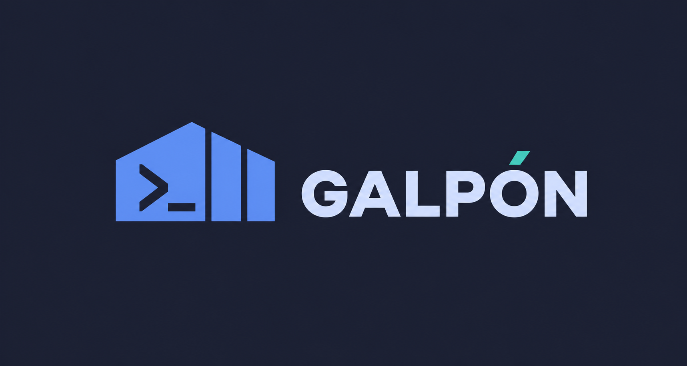
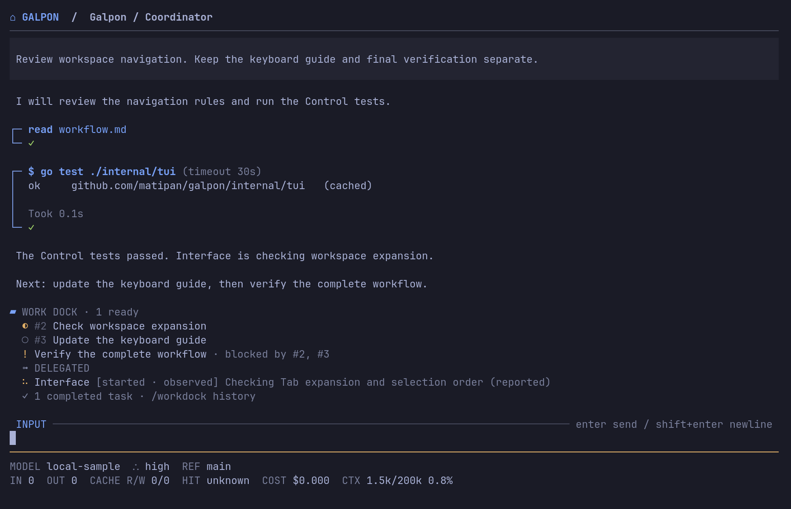
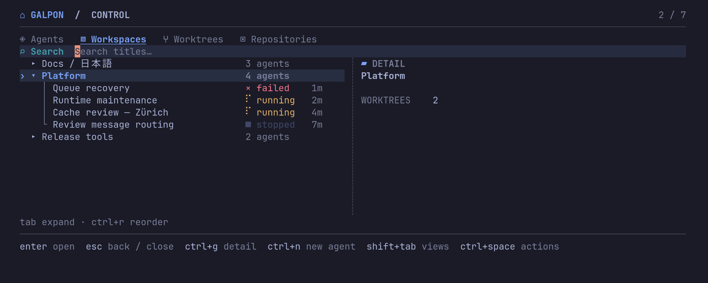
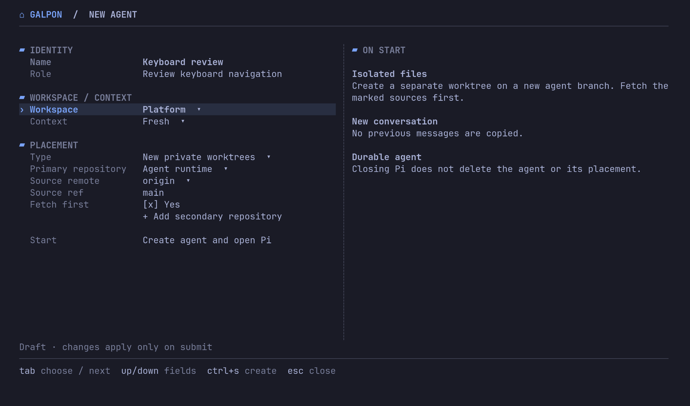

<p align="center">
  
</p>

# Galpon

**A terminal-first workstation for durable coding agents.**

**Try the interactive browser demo at [galpon.dev](https://galpon.dev).** It
simulates Herdr, Pi, the command center, the Work Dock, and Pi background
tasks. It runs only in the browser and cannot change your files.

Galpon manages durable workspaces and Git worktrees for you and your
[Pi](https://github.com/earendil-works/pi), Claude Code, and Codex coding agents.
Pi is the default. Each agent gets a persistent identity and a fixed harness.
Close a view, open the worktree or agent again, and Galpon restores the same
managed files and native conversation. Claude Code and Codex integrations use
preview APIs; read the [harness requirements](docs/harnesses.md) before use.

Use Galpon to:

- manage several coding agents from one command center;
- create a private Git worktree for your own terminal work;
- give each agent a private Git worktree, and keep the extra worktrees that it
  makes for later features and reviews in its own managed folder;
- group related human and agent work in a workspace;
- fork an existing agent context without sharing its files;
- let agents send work and results to each other;
- see your GitHub pull requests, the agent that opened each one, and the next
  step for each, in the command center;
- track local TODOs and delegated work in the Pi Work Dock;
- let Pi agents wait for background commands and monitors without polling;
- inspect current work, attention, and results in read-only Operations;
- review completed responses in an isolated Neovim interface;
- follow and dispatch agent work from the optional phone companion;
- open your real terminal and `$EDITOR` in the correct worktree;
- use Galpon in the Herdr desktop app, also from a second computer.

Galpon does not include a terminal emulator, browser terminal, file browser,
editor, or diff viewer. Its optional browser companion is a narrow agent
conversation, progress, feedback, and launch surface.

## Galpon in action

Native Galpon and Pi screens with sample conversations, tasks, and agents.

<p align="center">
  
  <br>
  <em>A Pi conversation with native tool output and the Work Dock.</em>
</p>

<p align="center">
  
  <br>
  <em>Control: press Tab on a workspace to show its agents, with recent activity first.</em>
</p>

<p align="center">
  
  <br>
  <em>New Agent: select context and file placement, then review what Start will do.</em>
</p>

### Interface map

| Surface | Open it | Purpose |
| --- | --- | --- |
| Herdr workspace | `herdr` | Durable terminal spaces, agent tabs, and real terminals |
| Herdr app | The desktop app, after `galpon herdr-app install` | The command center, New Agent, and the Galpon sidebar layout in the Herdr desktop app, also on a second computer |
| Command center | <kbd>Ctrl</kbd>+<kbd>K</kbd> or `galpon` | Search and act on agents, workspaces, worktrees, and repositories |
| New Agent | <kbd>Ctrl</kbd>+<kbd>N</kbd>, <kbd>a</kbd>, or <kbd>Ctrl</kbd>+<kbd>F</kbd> | Choose identity, context, workspace, and file placement |
| Pull requests | <kbd>Alt</kbd>+<kbd>P</kbd> in the command center | See your open pull requests in Galpon repositories, grouped by the next step, with the agent that opened each one |
| Pi Work Dock | Appears above the Pi editor | See local TODOs and delegated work; <kbd>Ctrl</kbd>+<kbd>Shift</kbd>+<kbd>T</kbd> collapses it |
| Background tasks | <kbd>Alt</kbd>+<kbd>T</kbd> or `/tasks` in Pi | See the background commands and monitors of the agent and their output |
| Operations | Select an agent and press <kbd>o</kbd>, or run `/operations` in Pi | Inspect bounded current work, attention, results, and safe activity |
| Review | `/review` or `/review pick` | Comment on a completed response in isolated Neovim |
| Companion | `galpon companion --listen 127.0.0.1:8420` | Follow agents, send feedback, and launch constrained agents from a phone |
| Browser demo | [galpon.dev](https://galpon.dev) | Try a safe simulation without a daemon, terminal, model, or file access |

## Quick start

### 1. Install the requirements

You need Git 2.45 or newer, Go 1.26.5 or newer, Pi 0.99.2 or newer, and
[Herdr](https://herdr.dev/). Galpon uses Pi by default and Herdr to open terminal
workspaces. The optional adapters are tested with Claude Code 2.1.316 and Codex
0.155.1. Install and authenticate each optional harness through its own CLI.
Galpon uses `pi`, `claude`, and `codex` from `PATH`. You control their versions;
Galpon does not install, upgrade, downgrade, or replace these binaries.

Install Pi:

```bash
npm install -g --ignore-scripts @earendil-works/pi-coding-agent
pi
```

In Pi, run `/login` and sign in to OpenAI Codex. This is the default provider
in Galpon. You can select a different provider later with environment
variables.

Install Herdr on macOS or Linux:

```bash
curl -fsSL https://herdr.dev/install.sh | sh
```

See the [Herdr installation guide](https://herdr.dev/docs/install/) for other
installation methods.

### 2. Install Galpon

Install Galpon from a source checkout:

```bash
git clone https://github.com/matipan/galpon.git
cd galpon
go install ./cmd/galpon
```

Make sure that `$(go env GOPATH)/bin` is in your `PATH`, then verify the
installation:

```bash
galpon --version
```

### 3. Add Galpon to Herdr

```bash
galpon herdr install
herdr
```

The install command adds one marked Galpon block to your Herdr configuration.
It preserves your other Herdr settings. Each popup is 88% by 88%.

- <kbd>Ctrl</kbd>+<kbd>K</kbd> opens the command center.
- <kbd>Ctrl</kbd>+<kbd>Alt</kbd>+<kbd>N</kbd> opens the New Agent form. It selects the workspace and source repository of the active Galpon agent. You can change both selections.

These are the only global Herdr bindings that Galpon installs. In the command
center, <kbd>Ctrl</kbd>+<kbd>N</kbd> opens the New Agent form for the selected
row, and <kbd>Ctrl</kbd>+<kbd>S</kbd> opens the Add Repository form. Agent
forking and Operations also use command-center keys.

Galpon does not bind a key globally when its own screens use that key. Herdr UI
runs a Herdr binding before an open popup gets the key, so a global
<kbd>Ctrl</kbd>+<kbd>S</kbd> binding would stop <kbd>Ctrl</kbd>+<kbd>S</kbd> in
Galpon forms. Pi, Neovim, and shells also keep these keys.

The context-aware shortcuts reject a stale, unmanaged, or incorrect pane
context. They do not use the popup pane as the active pane.

If Herdr was already running, reload its configuration:

```bash
herdr server reload-config
```

You can also run `galpon` in any terminal to open the command center directly.

To use Galpon in the Herdr desktop app as well, also from a second computer,
see [Herdr app](#herdr-app).

### 4. Create your first agent

Open the Galpon command center with <kbd>Ctrl</kbd>+<kbd>K</kbd>. Then:

1. Press <kbd>r</kbd>. Add a local Git repository path or an SSH/HTTPS Git URL.
2. Press <kbd>w</kbd>. Create a workspace for the task.
3. Select the workspace and press <kbd>a</kbd>.
4. Enter an agent name and select its repository placement.
5. Press <kbd>Ctrl</kbd>+<kbd>S</kbd> to create the agent and open Pi.

Galpon creates a private managed worktree for the agent. Work in Pi as usual.
To resume the agent, open the command center, select the agent, and press
<kbd>Enter</kbd>.

### Open a worktree without an agent

You can start with your own terminal work:

1. Select a repository and press <kbd>t</kbd>.
2. Create a new task workspace or select an existing workspace.
3. Keep the default remote and reference, or change them.
4. Press <kbd>Ctrl</kbd>+<kbd>S</kbd>.

Galpon creates a managed worktree and opens a real terminal in it. The
worktree stays durable after the terminal closes. Select the worktree later to
open it again. You can also select it and press <kbd>a</kbd> to create an agent
with a private fork or an explicit exact share.

## Herdr app

The [Herdr app](https://github.com/herdrdev/herdr-app) is the desktop app of
the Herdr project. It runs its terminals in herdr-core (`hc`), and it can show
the terminals of other computers. Galpon adds these parts to the app:

- the command center as native app UI, on <kbd>Ctrl</kbd>+<kbd>K</kbd>;
- the New Agent form, on <kbd>Ctrl</kbd>+<kbd>Alt</kbd>+<kbd>N</kbd>;
- agents in a tab: the harness choices **Pi app** and **Claude app** open a
  Pi or Claude Code agent in a native tab of the app instead of a terminal;
- the Galpon layout: a sidebar with the agents of each workspace and the pull
  requests that need someone, with the turns that need you first;
- screens: another computer, for example a laptop, shows and uses the agents
  of the computer that runs Galpon.

The Galpon parts of the app have one look, Taller: neutral surfaces, hairline
lines, Geist type and key chips. They take their colors from the theme of the
app, as the terminals do, so they sit on the same background and follow a
theme change. The accent of the theme marks only the focus, the main action
and the tab that the window shows. Each state has one color: purple works,
yellow needs you, green is ready and red failed. When the green or purple of
the theme has another hue, for example the blue green of Rosé Pine, Galpon
makes a true green or purple in the style of the other theme colors.

The app support is experimental. It is tested with herdr-app 0.1.14 and
herdr-core 0.1.19. Herdr and the app can run at the same time. An agent
opens in the terminal app where you open it. Keep Herdr installed also when
you use only the app: an agent that was never open in a terminal app, for
example a new agent from the Companion, opens in Herdr.

### Set up the app

1. Install the Herdr app. The installer also installs herdr-core when it is
   missing. The [Herdr app README](https://github.com/herdrdev/herdr-app)
   gives the requirements and the other ways to install it.

   ```bash
   curl -fsSL https://releases.herdr.dev/app/install.sh | sh
   ```

2. Open the app once, so that it writes its keys file,
   `~/.config/herdr-app/keys.json`.
3. Install the Galpon mods:

   ```bash
   galpon herdr-app install
   ```

4. In the app, press <kbd>Ctrl</kbd>+<kbd>K</kbd> to open the command center.
   Press <kbd>Ctrl</kbd>+<kbd>Shift</kbd>+<kbd>L</kbd> to go to the Galpon
   layout. The same key goes to the next layout, for example back to your
   main layout.

`galpon herdr-app install` writes the Galpon mods to `~/.config/herdr-app/mods`,
the Galpon layout to `~/.config/herdr-app/layouts`, and the barn sounds to
`~/.config/herdr-app/sounds`. It adds <kbd>Ctrl</kbd>+<kbd>K</kbd> and
<kbd>Ctrl</kbd>+<kbd>Alt</kbd>+<kbd>N</kbd> to the global section of
`keys.json`, and <kbd>Ctrl</kbd>+<kbd>Alt</kbd>+<kbd>J</kbd> and
<kbd>Ctrl</kbd>+<kbd>Alt</kbd>+<kbd>B</kbd> to the section of the Galpon
layout. It keeps your other keys, tells you about
each key that it replaces, and saves your first `keys.json` as
`keys.json.before-galpon`. The app loads the changes at once.

The mods come from the `galpon` executable and contain its path. Run
`galpon herdr-app install` again after you install a new `galpon` or move it.
A screen does this by itself; see
[Use the app on another computer](#use-the-app-on-another-computer).

To remove Galpon from the app, first run `galpon herdr-app sounds default`.
Then delete the `galpon`, `galpon-new-agent`, `galpon-sidebar`, and
`galpon-agent` folders in
`~/.config/herdr-app/mods`, `galpon.json` and `galpon.svg` in
`~/.config/herdr-app/layouts`, and the `galpon-*.mp3` files in
`~/.config/herdr-app/sounds`. Then remove the Galpon keys from
`keys.json`, or copy `keys.json.before-galpon` back if you did not change your
keys after the first install.

### Use Galpon in the app

- <kbd>Ctrl</kbd>+<kbd>K</kbd> opens the command center as native app UI: a
  command palette with the Agents, Pull requests, Workspaces, Worktrees and
  Repositories views, search, and a preview pane. It has the keys and the
  forms of the terminal command center: New Agent (Ctrl+N), Fork (Ctrl+F),
  Add Repository (Ctrl+S), New Workspace, Add Remote and New Worktree.
  <kbd>Ctrl</kbd>+<kbd>Space</kbd> or a right click on a row opens its
  actions: message, terminal, editor, operations, new agent, fork, rename,
  open in a tab or in a terminal, and hide or unhide. A message draft stays
  in the app until you send it. The command center reads Galpon every two
  seconds while it is open.
- <kbd>Ctrl</kbd>+<kbd>Alt</kbd>+<kbd>N</kbd> opens the New Agent form for
  the workspace of the focused terminal.
- A slow action, such as a repository clone, runs in its own Galpon process.
  It continues after you close the command center, and an open command
  center shows its result.
- An agent opens where you open it: the command center in the app opens it in
  the app, and the command center in Herdr opens it in Herdr. A message from the
  Companion or another agent opens a closed agent where it was open last.
- Each Galpon workspace is a space, and each agent is a tab. Galpon starts the
  agent through your `$SHELL` in interactive mode, so it gets the same
  environment as a terminal that you open. That shell gets
  `DISABLE_AUTO_UPDATE=true`, so the oh-my-zsh update question cannot stop
  the agent. The app shows the agent tab when its window is open. Galpon
  names the space and the tab, and focuses the agent, only while the window
  is open.
- An agent runs in one place. If an idle agent runs in the other terminal app,
  the first open tells you, and a second open moves it. Its process restarts
  and continues the same conversation; Pi background tasks of that process
  stop. Galpon does not move an agent that is working.
- The app sidebar shows the status that Pi, Claude Code, and Codex report.
  Galpon status text, such as delegated work, shows only in Herdr, the
  command center and the Galpon layout. The agents in a tab show only in the
  Galpon layout; see [Agents in a tab](#agents-in-a-tab).
- A `galpon` command in a terminal of the app opens its agents and terminals
  in the app. To do the same from another terminal, set
  `GALPON_RENDERER=herdr-app`.

### The Galpon layout

The Galpon layout replaces the app sidebar and tab bar with a Galpon sidebar.
Press <kbd>Ctrl</kbd>+<kbd>Shift</kbd>+<kbd>L</kbd> in the app to go to the
next layout. The Galpon layout starts with the theme of your main layout.

- Each workspace lists its open agents: first the agents that need you,
  then the agents that are ready for you, then the running agents, then the
  idle agents. An agent with delegated work that is not done yet runs, for
  every harness. A Pi agent whose turn ended while its background commands
  or monitors run also runs: they send it a notice later, so it is not your
  turn. The other tabs of the workspace come last. Rows do not move while
  the pointer is on the list, and an agent that you look at keeps
  its place until you go to another tab. A click shows the agent, and
  <kbd>Alt</kbd>+<kbd>Up</kbd> and <kbd>Alt</kbd>+<kbd>Down</kbd> follow the
  order of the list.
- Below, the pull requests that need someone: NEEDS YOU, AGENT'S TURN and
  WAITING, as in the command center. A click opens the agent of the pull
  request, or GitHub when it has no agent.
- Marks show the state; the tooltip of a row gives it in words. The command
  center uses the same states:

  | Mark | State |
  | --- | --- |
  | yellow dot | Needs you: the agent waits for your answer, or a pull request asks for your review. |
  | green dot with a check | Ready for you: the agent finished while you did not look, or a pull request is approved and ready to merge. |
  | purple dot that fades out and in | Running: the agent works, or the checks of a pull request run. The number is the running time. |
  | branch icon | Delegating: the agent waits for its delegated agents. The number counts them. |
  | clock | Waiting for background tasks: a Pi agent ended its turn, and its background commands or monitors still run. The number counts them. |
  | red `×` | Agent's turn: the checks of a pull request fail, or it has conflicts, requested changes or open threads. |
  | dashed ring | Pending: a pull request waits for a review, or an agent did not report its status yet. |
  | gray ring | Idle. |
  | terminal icon | A plain terminal. |

  The row of the tab that the window shows has the accent color. Only the
  dot of a running row moves. Until you look at a row that needs you or is
  ready for you, its turn is new: the dot is filled, the check is cut out of
  a green dot, and the row has a faint band and a bold title. After you
  look, the turn is seen: the dot is a ring and the check is plain, until
  the state changes. The app makes an
  agent that is ready for you idle when you look at it, so only agents that
  need you and pull requests show seen turns. A pull request is seen when
  you open it. A folded workspace shows these turns on its header, and
  headers count the states with small pills: filled when a turn in the count
  is new. Red means only that something went wrong. The pane headers and the
  status bar of the Galpon layout use the same marks.
- The Workspaces title counts the turns of all workspaces, also when the
  list scrolls or a workspace is folded. A click on the counter, or
  <kbd>Ctrl</kbd>+<kbd>Alt</kbd>+<kbd>J</kbd>, goes to the next turn: the
  agents that need you first, then the agents that are ready for you, and
  the one that waited longest first. Use it again to go to the next one.
  A click on the counts in the status bar does the same, and the key also
  works while the sidebar is hidden. The app can also play a sound and show
  a notification when an agent needs you or finishes while you do not look
  at it: see Settings > Alerts in the app.
- A right click on a row opens its menu. An agent has Message, Terminal,
  Editor, Fork, Rename, Close and Hide, and a Pi or Claude Code agent also
  has Open in a tab or Open in a terminal; most of them open the command center on that
  action. Close ends the terminal of the agent. The agent stays in Galpon,
  and a message or the command center opens it again. Close is off while the
  agent works or waits for you in its terminal, because Galpon would open it
  again to finish its turn. Close also stops the background tasks of a Pi
  agent, and the menu says so. A plain terminal has Rename and Close, a
  workspace has New agent here and New terminal, and a pull request has Open
  agent, Open on GitHub and Refresh.
- The sidebar reads Galpon every 30 seconds and when an open agent changes.
  It does not start Galpon, and it does not make Galpon call GitHub. The
  refresh button gets the pull requests from GitHub now. A read that does
  not answer in 40 seconds counts as failed, and the states, alerts and
  counts of the open agents do not wait for it. When a read fails, or when
  the last good read is older than 2 minutes, a line under the list says
  so, for example "Galpon data from 3m ago."

#### The barn

The barn is a small farm below the terminals of the Galpon layout. It shows
the agents of the sidebar as animals. It is hidden at first. Press
<kbd>Ctrl</kbd>+<kbd>Alt</kbd>+<kbd>B</kbd>, or click the barn mark in the
status bar, to show or hide it. The app keeps your choice after a restart.

- Each workspace is a pen, with its name below it. Each open agent is an
  animal: a cow for Pi, a horse for Claude Code, a goat for Codex, and a pig
  for other agents. The pens and the animals have the order of the sidebar.
- Each animal has a small brain. When it ends an action, it selects the
  next one from the state of its agent:

  | State | In the barn |
  | --- | --- |
  | Needs you | It hurries to the gate of its pen, looks at you and moos, under a yellow `!` badge. |
  | Ready for you | It jumps one time when the agent finishes. Then it lies down next to a full milk bucket, under a green `✓` badge, and chews. |
  | Running | It pulls a plow from one end of its lane to the other, and stops to eat from time to time. The furrow gets longer while the agent runs. |
  | Delegating | A sheepdog herds one sheep for each delegated agent. |
  | Waiting for background tasks | A hen sits on one egg for each task. When a task ends, its egg hatches, and the chick stays for 10 minutes. |
  | Idle | It sleeps. From time to time it wakes up, walks, eats, meets a neighbor nose to nose, and lies down again. After 30 minutes, a bird sits on it. |
  | No status yet | It is pale, and it walks and eats in its pen. |

  The badges are filled for a new turn and an outline for a seen turn, as
  in the sidebar. A line under an animal shows the agent that has the focus.
  When the pointer is on an animal, it stops and looks at you.
- A Pi cow shows what its session cost at API prices, also when a
  subscription pays for it. Galpon reads the cost from the session file of
  the agent.
  - The cow weighs one pound for each dollar. Its weight gives its size: a
    newborn calf below $100, a calf below $500, a young cow below $1,000, a
    cow below $1,500, and a bull with horns and a nose ring from $1,500. A
    heavy cow walks slowly and breathes hard, and a calf walks fast and
    hops.
  - A yellow ear tag shows the price.
  - Prizes: a bell from $100 ("cash cow"), a blue ribbon from $500 ("prize
    cow"), gold spots from $1,000 ("Wagyu") and a halo from $1,500 ("holy
    cow").
  - Its pen gets one cow pie for each $100, and flies circle the newest pie.
  - While the agent runs, coins rise from the cow: more coins when the
    session cost more in the last 10 minutes.
  - The cattle scale next to the henhouse shows the weight of all Pi cows,
    or of the cow under the pointer.
- Pull requests: a truck takes one hay bale for each pull request that is
  ready to merge. The mailbox raises its yellow flag for review requests. A
  red fox visits the henhouse when a pull request is the agent's turn.
- The windmill turns while an agent runs, and faster when more agents run.
  From 20:00 to 6:00, the sky has stars and a moon.
- A click on an animal shows its agent, and a right click opens its menu, as
  in the sidebar. A click on a hay bale, the mailbox or the fox opens the
  pull request as the sidebar does. A click on the barn opens the command
  center.
- The barn gets its Galpon data from the sidebar, so it does not read
  Galpon.

#### Barn sounds

The barn sounds are off at first. Turn them on with the ♪ button of the
barn, or run:

```bash
galpon herdr-app sounds barn
```

- The app plays a moo when an agent needs you, and a rooster when an agent
  finishes while you do not look at it. These are the alert sounds of the
  app: the command sets other files for them in `settings.json`, so you hear
  one sound, not two. They play in every layout, for every agent in the app.
- In the Galpon layout, a cluck plays when a background task of a Pi agent
  ends.
- `galpon herdr-app sounds default` selects the sounds of the app again. It
  keeps the sound files that you selected yourself. `galpon herdr-app sounds`
  tells which sounds the app plays.
- The sound switch in Settings > Alerts of the app turns off all sounds, also
  the cluck.

### Agents in a tab

A Pi or Claude Code agent can open in a tab of the app instead of a
terminal: the agent tab. It shows the conversation with native app elements:
each run folds into a work log with its steps and the files that it changed,
the composer holds the model, the thinking level and the context ring, and a
panel on the right shows the changes, the tasks and the delegated agents. It
is the same Galpon agent as in a terminal: it has the Galpon tools, it
delegates, and other agents, the Companion and you can send it messages.
The agent tab is tested with Pi 1.5.0 and Claude Code 2.1.316.

- In the New Agent form, select the harness **Pi app** or **Claude app**.
  The name is optional for them: the first message names the agent. To make
  one the default of the forms, the CLI and the Companion, set
  `default_harness = "pi-app"` or `"claude-app"` in the
  [configuration](#configuration), or use `--harness pi-app` or
  `--harness claude-app` with `galpon agent create`.
- Galpon opens the agent in the tab `galpon-<agent>` of the space of its
  workspace. A host process, `galpon herdr-app host <agent>`, runs Pi or
  Claude Code for it in a hidden herdr-core terminal on the computer that
  runs Galpon; the tab only shows it. The sidebar, the pane header and the status bar show the
  state of the host. The Galpon layout plays the alert sound and shows a
  notification when an agent in a tab needs you or finishes while you do not
  look at it.
- Close the tab when you like. The agent keeps running and finishes its
  turn. A host that has no tab for 5 minutes and nothing to do stops. A
  message wakes the agent: Galpon starts its host and opens its tab again,
  without the focus. The conversation stays in the Pi session of the agent.
- In the tab: <kbd>Enter</kbd> sends, <kbd>Shift</kbd>+<kbd>Enter</kbd> adds a
  line, and <kbd>Alt</kbd>+<kbd>Enter</kbd> queues a message for after the
  run. While the agent works, <kbd>Enter</kbd> steers the run and
  <kbd>Esc</kbd> stops it. <kbd>Ctrl</kbd>+<kbd>L</kbd> chooses the model,
  <kbd>Shift</kbd>+<kbd>Tab</kbd> changes the thinking level, <kbd>/</kbd>
  lists the commands, and <kbd>Alt</kbd>+<kbd>W</kbd> and
  <kbd>Alt</kbd>+<kbd>D</kbd> open the Tasks and Agents panels. <kbd>Up</kbd>
  in an empty composer selects the messages: <kbd>Up</kbd> and
  <kbd>Down</kbd> move, <kbd>Enter</kbd> opens a step, <kbd>C</kbd> copies,
  and <kbd>Esc</kbd> goes back to the composer.
- Open in a terminal, in the menu of the agent, moves an idle agent from its
  tab to a terminal, and Open in a tab moves it back. The agent restarts with
  the same conversation. The CLI does the same:
  `galpon agent view <agent> terminal|app`.
- A screen shows the agent tab too. The tab talks to the host of the agent
  through herdr-core, and it copies the images of the conversation to the
  screen.
- Only Pi and Claude Code agents can open in a tab. One process runs each
  session: an agent in a tab does not also run in a terminal.

A Claude Code agent in a tab runs Claude Code in its headless mode, with
your Claude login and settings. With Claude Code 2.1.278, a turn that uses a
Galpon tool gets no reply. These parts are different from Pi:

- Claude Code asks before it edits files or runs commands. The question
  shows in the tab with the command or the change, and you allow it once,
  allow it from now on, deny it, or deny it and tell Claude what to do. The
  questions of Claude and the approval of a plan show in the same way.
- The chip after the effort shows the permission mode: Ask first, Accept
  edits, Plan, Auto, or Bypass. <kbd>Shift</kbd>+<kbd>Tab</kbd> goes through
  the first four modes, as in the terminal of Claude Code, and the chip menu
  also has Bypass. The tab keeps the model, the effort and the mode of the
  agent for its next start, but not Bypass.
- The slash commands of Claude Code that work without its terminal show in
  the <kbd>/</kbd> list. Commands that end or replace the conversation, such
  as `/clear` and `/resume`, do not work: the conversation belongs to the
  Galpon agent, so create another agent for a new conversation.
- Subagents and background commands show in the Tasks panel, and a notice in
  the conversation tells when one ends.

### Use the app on another computer

Galpon runs on one computer: the host. The daemon, the agents, the
repositories, and the worktrees stay on the host. Another computer with the
Herdr app, a screen, shows the agents of the host and works with them. For
example, your desktop computer is the host, and your laptop is a screen. The
agents continue to run on the host when the laptop sleeps.

You need:

- Galpon and the Herdr app on the host.
- SSH from the screen to the host that logs in without a prompt, with a key
  or an SSH agent. herdr-core and Galpon use SSH in batch mode, so they
  cannot ask for a password.
- The same OS and CPU on the two computers, so that the screen can use the
  `galpon` executable of the host. Otherwise, you must install the same
  `galpon` on the screen by hand after each change on the host.
- No Galpon on the screen: a screen does not run its own daemon or keep
  Galpon data. If it has Galpon data, `galpon connect` stops and tells you
  where the data is.

#### Connect a screen

Do these steps on the screen. The examples use `desk` as the name of the
host.

1. Install the Herdr app, with the same version as on the host, and open it
   once.
2. Add the host as a herdr-core machine. In the app, use Settings > Machines >
   Add machine, or run:

   ```bash
   hc machine add <ssh target> --name desk
   ```

   The SSH target can be a `Host` of `~/.ssh/config` or `user@address`.
   Galpon needs a machine that SSH reaches. It cannot use a machine that you
   add with `--via`.
3. Put a `galpon` executable in a folder of your `PATH` that you can write,
   for example `~/.local/bin`. Install it from source as in
   [2. Install Galpon](#2-install-galpon), or copy it from the host. On the
   host, `galpon version --json` shows the path of the executable:

   ```bash
   scp <ssh target>:<path on the host> ~/.local/bin/galpon
   ```

4. Connect, and then check the connection:

   ```bash
   galpon connect desk
   galpon status
   ```

`galpon connect` uses the SSH target of the herdr-core machine. It finds
`galpon` with the login shell of the host, or uses `--host-galpon <path>`. It
saves the setting in `~/.config/galpon/screen.json`. Then it copies the
`galpon` of the host over the `galpon` of the screen when the two builds are
different, and installs the Galpon mods, the layout, and the keys for the
host. `galpon status` shows the host, the `galpon` of each computer, and the
state of the daemon on the host.

#### Work on a screen

- Each `galpon` command runs on the host over SSH, with the terminal of the
  screen, and gives back its output and its exit code. `galpon` alone opens
  the command center of the host in the terminal. A path in a command is a
  path on the host.
- `galpon connect`, `galpon status`, `galpon disconnect`, `galpon version`,
  `galpon herdr-app install` and `galpon herdr-app sounds` run on the screen.
  So the screen and the host can have different sounds.
- `galpon serve`, `galpon pi` and `galpon runtime` stop with an error, because
  Galpon and its agents run on the host.
- When a command opens an agent or a terminal, the screen names its tab and
  its space and focuses it in the app. The window of the host keeps its
  focus. Pull request links open in the browser of the screen.
- When a command of the screen starts the daemon, for example
  `galpon daemon restart`, herdr-core on the host starts it. Thus the daemon
  gets the environment of the desktop session of the host, with its SSH
  agent, as agent terminals do. It does not get the environment of the SSH
  login.
- The mods of the screen run `galpon` on the host through herdr-core
  (`hc exec --on <name>`). Add Repository asks for a path on the host. Each
  Galpon call goes over SSH, so it is slower on a slow connection.
- The app of the screen shows the terminals that run in herdr-core on the
  host: the agents and terminals that Galpon opens in the app. An agent that
  is open in Herdr on the host does not show. Open it from the screen to
  move it to the app.

#### Updates

The screen keeps the `galpon` build of the host:

- When the build on the host changes, the screen copies the new `galpon` over
  its own `galpon`, and installs the Galpon mods of that build. The app loads
  them at once. A command of the screen starts this update when the host has
  another build. The command center and the sidebar of the app start it too,
  and so does `galpon status`. The update runs in the background, and
  `~/.local/state/galpon/screen-update.log` has its output.
- A build is the Go build ID of the program, so a new build without a commit
  also counts. The screen follows the host also to an older build.
- Each update finds `galpon` on the host again, for example after a move to
  the folder of a new Go version, unless `--host-galpon` gave the path.
- The two computers must have the same OS and CPU, and the screen must be
  able to write the folder of its `galpon`, for example `~/.local/bin`.
  Otherwise `galpon status` shows the error, and you install `galpon` by
  hand. After a failed update, the next one waits a minute.

#### Stop being a screen

Run `galpon disconnect`. Then `galpon` commands run on this computer again.
The mods in the app use the host until you run `galpon herdr-app install`
again, or remove them as in [Set up the app](#set-up-the-app).

## Command center

The command center is labeled **Control**. It opens in the Agents view.
Press <kbd>Shift</kbd>+<kbd>Tab</kbd> to change the view, in this order: Agents,
Pull requests, Workspaces, Worktrees, and Repositories. Press
<kbd>Alt</kbd>+<kbd>P</kbd> in any view to open Pull requests, and press it again
to go back to the earlier view. Wide terminals
show equal list and detail panels. Press <kbd>Ctrl</kbd>+<kbd>G</kbd> to open the
selected item's full detail.

**Search** mode accepts title text. **Action** mode accepts one-key commands.
Press <kbd>Ctrl</kbd>+<kbd>Space</kbd> to change modes. The footer shows the valid
keys for the current width and mode.

Search checks human-facing agent, workspace, worktree, and repository titles.
It does not search IDs, paths, conversation text, or file contents. Agents stay
first, followed by workspaces, worktrees, and repositories. Each search change
selects the first result and closes earlier category expansions. Each category
shows up to ten matches. Select a **More…** row and press <kbd>Tab</kbd> or
<kbd>Enter</kbd> to show or hide its remaining results.

Background refreshes update states but keep the current order and selection.
Press <kbd>Ctrl</kbd>+<kbd>R</kbd> to reorder from the latest facts. A search
change also resets the order. With an empty search, the Agents view places
agents that need attention first and limits older idle rows. Expand the older
rows or a parent's delegated agents with <kbd>Tab</kbd>.

Select a workspace and press <kbd>Tab</kbd> to show its agents below that row,
with the most recent activity first. The list includes older and delegated
agents. During search, it also includes agents whose titles do not match the
query. Press <kbd>Tab</kbd> on the workspace again to collapse the list. Search
text changes collapse workspace lists; background refreshes keep them open.

| Key | Mode | Action |
| --- | --- | --- |
| <kbd>↑</kbd> or <kbd>Ctrl</kbd>+<kbd>P</kbd> | Both | Select the previous result |
| <kbd>↓</kbd> | Both | Select the next result |
| <kbd>Enter</kbd> | Both | Open an item or expand a disclosure row |
| <kbd>Tab</kbd> | Both | Expand or collapse workspace agents, more results, older items, or delegated agents |
| <kbd>Ctrl</kbd>+<kbd>Space</kbd> | Both | Change between Search and Action mode |
| <kbd>Shift</kbd>+<kbd>Tab</kbd> | Both | Change resource view |
| <kbd>Alt</kbd>+<kbd>P</kbd> | Both | Open Pull requests, or go back to the earlier view |
| <kbd>Ctrl</kbd>+<kbd>O</kbd> | Both | Open the selected pull request on GitHub |
| <kbd>Ctrl</kbd>+<kbd>G</kbd> | Both | Open or close full detail |
| <kbd>Ctrl</kbd>+<kbd>R</kbd> | Both | Reorder from current facts; in Pull requests, also get new data from GitHub |
| <kbd>Ctrl</kbd>+<kbd>N</kbd> | Both | Create an agent with defaults from the selected workspace, agent, or worktree |
| <kbd>Ctrl</kbd>+<kbd>F</kbd> | Both | Prefill a new agent from the selected agent's conversation and placement |
| <kbd>Ctrl</kbd>+<kbd>S</kbd> | Both | Add a repository |
| <kbd>Ctrl</kbd>+<kbd>H</kbd> | Both | Show or hide hidden resources |
| <kbd>r</kbd> | Action | Add a repository |
| <kbd>R</kbd> | Action | Add a named Git remote |
| <kbd>w</kbd> | Action | Create a workspace |
| <kbd>a</kbd> | Action | Create an agent in the selected workspace |
| <kbd>t</kbd> | Action | Open a worktree in a real terminal, or create one from a repository |
| <kbd>e</kbd> | Action | Open a worktree in `$EDITOR`, or create one from a repository |
| <kbd>o</kbd> | Action | Open read-only Operations for the selected agent |
| <kbd>x</kbd> | Action | Ask to hide or restore the selected item; confirm with Enter |
| <kbd>m</kbd> | Action | Write a message to the selected agent |
| <kbd>n</kbd> | Action | Rename the selected agent |
| <kbd>q</kbd> or <kbd>Esc</kbd> | Action / Search | Close the command center |

Hidden resources stay durable. <kbd>Ctrl</kbd>+<kbd>H</kbd> includes them in the
same stable groups. A hidden row cannot open. Select it and press <kbd>x</kbd> to
request its restoration and that of any required related resources. Confirm
with <kbd>Enter</kbd>, or cancel with <kbd>Esc</kbd>.

Agent rows use separate state indicators. An amber spinner means working.
Amber `!` means attention is required. Green `✓` means confirmed success;
red `×` means failure. Idle, queued, stopped, and canceled states are muted.
A connected agent or a recent update does not imply success.

The Message view sends only when you select **Send message** and press Enter.
Escape retains the draft for that agent within the current popup. Closing the
popup discards its drafts and navigation state.

The Rename form gives the selected agent a new name, with the same rules as a
new agent. Other agents can have the same name. Galpon and the open tab of the
agent show the new name at once. A running Pi agent uses it in its system
prompt, its footer and its terminal title from its next turn, without a
restart. A running Codex or Claude Code agent gets the new name with its next
Galpon message, and Codex also gives it to its thread. Claude Code gets it in
its own instructions at its next start. Old messages keep the name that the
agent had when they were sent. Other agents find the agent by its new name or
by its ID.

### Pull requests

The Pull requests view shows your work on GitHub next to your agents. It needs
the [GitHub CLI](https://cli.github.com/) in the daemon's `PATH`, signed in with
`gh auth login`. Galpon calls GitHub only through `gh`, so it keeps no GitHub
token. When no Galpon repository has a GitHub remote, Galpon does not call
GitHub.

The view shows these pull requests in Galpon repositories. A pull request is in
a Galpon repository when its base or head repository is a remote of that
repository, such as your fork.

- your open pull requests;
- open pull requests that ask for your review;
- your pull requests that merged in the last 14 days while a Galpon worktree is
  still on their branch.

Groups show the next step:

| Group | Pull requests |
| --- | --- |
| **Needs you** | Approved with passing checks, or a review that you must give |
| **Agent's turn** | Failing checks, merge conflicts, requested changes, or open review threads |
| **Waiting** | Checks in progress, a review that you wait for, or a draft |
| **Merged, worktree left** | A Galpon worktree is still on the merged branch |
| **No activity for 30 days** | Open pull requests that nobody changed for 30 days |

The tab shows the number of **Needs you** and **Agent's turn** rows. Agent rows
show a badge with the most urgent open pull request of that agent, for example
`#5455 × +2`. The agent detail lists its pull requests.

Galpon links a pull request to the agent whose saved conversation ran
`gh pr create` and got the pull request URL. This works for Pi, Claude Code, and
Codex agents, for each saved conversation, and for `gh pr create` calls in a Pi
`codemode` script. A command that only searches for the text, such as
`rg 'gh pr create'`, does not make a link. When no conversation opened the pull request, Galpon uses the
agent that has the pull request branch checked out. For a merged pull request,
the agent is the owner of the worktree on its branch.

Press <kbd>Enter</kbd> to open the agent of the selected pull request. Without an
agent, <kbd>Enter</kbd> opens the pull request on GitHub, as
<kbd>Ctrl</kbd>+<kbd>O</kbd> does. Press <kbd>Ctrl</kbd>+<kbd>G</kbd> to see the
checks, review, conflicts, branch, worktree, and URL.

The daemon gets new data every five minutes. When you look at data that is older
than one minute, it gets new data again. Press <kbd>Ctrl</kbd>+<kbd>R</kbd> to get
new data at once. Each update reads only the new lines of saved conversations
and runs three GitHub searches.

### Forms and agent placement

The New Agent form separates **Identity**, **Workspace**, **Context**,
**Placement**, **Worktrees**, and **Action**. It supports a fresh conversation
or a context fork. File placement can use new private worktrees, private forks
of another agent's placement, a new managed directory, an external directory,
or an explicit exact share. A worktree placement can have one primary and
multiple secondary repositories.

<kbd>Ctrl</kbd>+<kbd>F</kbd> preselects the chosen agent as both context and
placement source. The placement uses private forks by default. You can change
each field before creation. A context fork does not share files, and a placement
copy does not copy conversation context unless you select both.

Form controls are consistent:

| Key | Action |
| --- | --- |
| <kbd>Tab</kbd> | Open a choice list, or move to the next field |
| <kbd>Shift</kbd>+<kbd>Tab</kbd>, <kbd>↑</kbd>, <kbd>↓</kbd> | Move between fields |
| <kbd>←</kbd> / <kbd>→</kbd> | Change a closed choice |
| <kbd>+</kbd> | Add a secondary repository in the New Agent form |
| <kbd>d</kbd> | Remove the selected secondary repository |
| <kbd>Ctrl</kbd>+<kbd>S</kbd> | Save, create, or start |
| <kbd>Esc</kbd> | Cancel or close |

Choice lists search visible names and workspace labels. Type to filter, use the
arrow keys, and press <kbd>Enter</kbd> to select. The New Worktree form uses the
same controls and can create a workspace as part of the operation.

## Pi Work Dock

The Work Dock is a persistent Pi panel above the editor. It appears when the
current session has local TODOs or work that this agent delegated. It combines
two data sources without merging their authority:

- **Todos** are Pi-local session state. Rows show `○` pending, an amber `◐` for
  work in progress, and green `✓` for completed work. Blocker labels
  identify dependencies. Run `/todos` to print the complete list.
- **Delegations** are daemon-observed request deliveries. Rows show `○` queued,
  an amber `◐` for started work, `!` waiting, `✓` completed,
  `×` failed or expired, and `⊘` canceled. Nested rows preserve delegation
  ancestry.

The heading shows TODO, ready, and delegation counts. A TODO is **ready** only
when its blockers are complete, it has no owner, all linked delegations are
settled, and no active daemon operation owns it. Readiness is visibility only;
it does not schedule or claim work.

The model also sees the open TODOs. Each TODO change returns the in-progress
and pending tasks, and each agent run starts with a hidden list of open tasks.
The TODO guidance tells the model to complete or delete finished, obsolete,
and replaced tasks before its final reply.

Delegation rows label lifecycle and lease facts as **observed**. Agent checkpoint
text is **reported**. A stale lease changes the label to a stale observation; it does not prove that an agent is stuck. Safe activity,
blockers, and bounded coordination facts can appear on the same row.

The Work Dock does not animate and has no redraw timer. It redraws only when
its tasks or delegation snapshot change. Pi's Working indicator shows that the
foreground agent is active.

Press <kbd>Ctrl</kbd>+<kbd>Shift</kbd>+<kbd>T</kbd> to collapse or expand the
panel. The console uses a height-limited compact view. It keeps active branches
and their parents visible and reports hidden or truncated work. Completed work
is hidden by default. Run `/workdock history` to show or hide completed work
without expanding tool output. Run `/todos` for the complete task list.
TODO subjects and snapshots stay in Pi; Galpon receives only bounded link,
settlement, and active-operation ownership facts.

The console preserves your Pi theme and native tool output. It adds shared
frames to Galpon tools, built-in tools, and the bundled TODO tool. Independent
extension tools keep their own renderers. Ordinary messages have no added
labels or separators. Use `/galpon-ui off` or `/galpon-ui on` to change console
presentation, and `/galpon-ui still` or `/galpon-ui motion` to control the Working indicator
and running-tool animation.
These commands do not change execution or session content.

See [the delegated work progress contract](docs/work-progress-v1.md) for the
reported checkpoint and projection rules.

## Pi background tasks

Galpon gives Pi agents the background tools of Claude Code, so that an agent
does not wait with `sleep` or poll an output file:

- `bash` with `run_in_background` returns at once with a task ID. When the
  command ends, the agent gets one notice with the exit code and the last
  output lines.
- `Monitor` runs a script. Each line that the script writes to stdout is an
  event. Lines that arrive within 200 ms come as one notice.
- `TaskStop` stops a task and its child processes. `TaskOutput` shows the
  status and the last output lines of a task.

While the agent works, its notices go to the model at the end of the current
turn, in one message. While the agent is idle, a notice starts a new turn.
A notice is not a message from the user. When a notice arrives after the final
answer of a run, Galpon keeps that final answer as the result of the request.

A monitor stops when its script exits, at its timeout (5 minutes by default, 1
hour at most), or with `TaskStop`. `persistent: true` removes the timeout.
Galpon stops a monitor that sends more than 30 notices or 500 lines in one
minute. Each task writes its full output to a private temporary file.

Tasks belong to the Pi process. They continue when Pi reloads its extensions,
and they stop when the session ends. The footer shows the number of running
tasks. The phone companion does not show notices.

<kbd>Alt</kbd>+<kbd>T</kbd> or `/tasks` opens a screen with the tasks of the
agent. Select a task to see its output. The output updates while the task
runs, and the screen stays at the end of the output until you scroll up. With
only one task, the screen opens its output at once. `/tasks <task ID>` opens
the output of one task. The screen shows the last 512 KiB of the output file.

## Read-only Operations

The Operations cockpit shows one bounded server projection for a selected
agent. It puts current work first and labels work as received or delegated.
Separate sections show attention, results, failures, and recent coordination.
Observed facts and agent reports stay separate. A checkpoint is current only
for the current started attempt while its lease is fresh. A stale lease is an
attention fact, not a stuck-state inference. Safe activity and direct Pi work
facts are scoped to the selected agent. Protocol diagnostics are secondary.

Open Operations with <kbd>o</kbd> on an agent in the command center. Use
<kbd>↑</kbd>/<kbd>↓</kbd> or <kbd>Ctrl</kbd>+<kbd>P</kbd>/<kbd>Ctrl</kbd>+<kbd>N</kbd>
to select work, <kbd>r</kbd> to refresh, and <kbd>q</kbd> or <kbd>Esc</kbd> to
return. In Pi, use `/operations`. Wide terminal layouts show agent work,
selected detail, and the selected agent summary.

The CLI provides text and versioned JSON output:

```bash
galpon operations Jefesito
galpon operations --json Jefesito
```

Galpon does not add a watch mode. The current clients already refresh through
their safe event or polling paths, but the CLI has no matching event contract.
The cockpit has no pause, cancel, retry, restart, cleanup, or steering controls.
TODO data remains in the Pi TODO extension. It is not copied into the daemon or
combined with delegated-work state.

## Terminal response review

Run `/review` inside a foreground Galpon Pi agent to review the latest completed
assistant response in Neovim. Run `/review pick` to select one of the 20 most
recent completed responses. Neovim is the only Review view.

Review is optional. It currently requires Linux, Neovim 0.11 or newer on `PATH`,
and `cc` for the first setup. Prepare the dependencies once:

```sh
galpon review setup
```

Setup builds the two Markdown parsers from bundled, pinned sources. It does
not start Galpon services or install Pi extension assets. Review launches do
not download or build dependencies. Neovim uses private HOME and XDG directories
and a small Galpon configuration. It does not load your Neovim configuration,
plugins, ShaDa, or sessions. Source panes, Markdown, line numbers, search,
completion menus, and the blue status line use Galpon's active palette, with
Tokyo Night Moon as the fallback. This is configuration isolation, not an
operating system sandbox.

Normal mode shows formatted Markdown. Visual mode shows the exact source.
Review keeps native Neovim motions, search, wrapping, and scrolling.

| Key | Action |
| --- | --- |
| <kbd>v</kbd> / <kbd>V</kbd>, then <kbd>c</kbd> | Comment on the selected source |
| <kbd>c</kbd> in normal source mode | Comment on the logical source line |
| <kbd>Esc</kbd>, then <kbd>Enter</kbd> in a comment | Save the comment; Enter in Insert mode adds a line |
| <kbd>Tab</kbd> | Change between source and annotation panes |
| <kbd>Enter</kbd> or <kbd>e</kbd> | Edit the selected annotation |
| <kbd>x</kbd> / <kbd>u</kbd> | Delete or restore an annotation change |
| <kbd>]</kbd><kbd>a</kbd> / <kbd>[</kbd><kbd>a</kbd> | Select the next or previous annotation |
| <kbd>s</kbd> | Prepare feedback and return it to the Pi editor |
| <kbd>q</kbd> | Close Review and keep the draft, including an unfinished comment |

Review does not bind <kbd>Ctrl</kbd>+<kbd>S</kbd>. In a comment, leave Insert
mode before pressing <kbd>q</kbd>. Preparing feedback does not send it and
requires confirmation before it replaces unsent Pi text, including
whitespace-only drafts. Saved comments and unfinished edits can be resumed with
`/review`. Saved drafts from the former Review editor remain supported; the old
editor itself has been removed.

Wide terminals show source and annotation columns. Narrow terminals use stacked
panes. Very small terminals show one main pane at a time. Neovim handles motions,
search, selections, wrapping, and resizing; Galpon preserves source ranges and
validates each saved draft before it returns to Pi.

See [the Review contract](docs/review.md) for recovery, isolation, and test details.

## Main concepts

- **Repository:** A local Git checkout or remote Git URL. Galpon imports its
  remotes and creates a shared bare mirror. It does not change or delete the
  original checkout.
- **Workspace:** A group of human and agent work for one task or project. A
  workspace can use one or more repositories.
- **Worktree:** A durable managed Git checkout in a workspace. It can exist
  without an agent and opens in your real terminal or editor.
- **Agent:** A durable conversation with a fixed harness and a file placement. An agent can use
  a managed directory, or it can have a primary worktree and secondary
  repository worktrees.
- **Placement:** The files that an agent can use. If you do not select a
  repository or another placement, Galpon creates a private managed directory.
  This is useful for coordinators and reviewers. New worktree placements are
  private by default. You can explicitly share another agent's exact worktree
  placement. An agent can add more worktrees to its placement later. See
  [agent folders and extra worktrees](#agent-folders-and-extra-worktrees).
- **Context fork:** A new conversation that starts from another agent's
  context. Omit the harness to inherit the source, or select another harness
  to convert its saved history, images, and effective context. A context fork
  does not change or share file placement. Cross-harness forks preserve completed tools as historical
  text, not executable calls. See [cross-harness forks](docs/harnesses.md#cross-harness-forks)
  for supported content and limits.

Galpon provisions a tested Pi package set in the active user Pi configuration before the daemon starts:

- `pi-image-tools@1.4.0`
- `pi-web-access@0.35.0`
- a vendored Galpon fork of `rpiv-todo@2.7.1`

The npm packages use exact Pi package pins. Galpon replaces the older
`pi-image-preview`, `pi-image-paste`, and upstream `@juicesharp/rpiv-todo`
entries to prevent duplicate tools and commands. The TODO fork is embedded in
the Galpon binary, registered as a local package in the user Pi configuration,
and loaded explicitly for every foreground and background agent. This keeps the
TODO tool and overlay available to direct Pi sessions. An existing Pi session
can load the bundled fork with `/reload`. If a required npm package is missing
while `PI_OFFLINE=1`, Galpon stops
with an installation error instead of starting an agent with an incomplete tool
set. Pi packages execute with the user's full system access.

### Built-in MCP support

Galpon uses Pi's built-in MCP support. It no longer installs or pins
`pi-mcp-adapter`. Existing adapter installations are left unchanged: the adapter
reads additional configuration files and uses a separate credential store, so
removing it automatically could disconnect servers. Galpon does not rewrite MCP
configuration or credentials.

To switch an existing installation:

1. Move the servers you need to `~/.pi/agent/mcp.json` (or
   `$PI_CODING_AGENT_DIR/mcp.json`) and trusted project `.pi/mcp.json` files.
   Pi's built-in MCP does not read shared `~/.config/mcp/mcp.json`, project
   `.mcp.json`, or adapter `imports` automatically. Review adapter-specific
   options: for example, replace `disabled: true` with `enabled: false`, and
   `directTools: true` with `exposure: "direct"`. Do not copy configurations
   without checking these differences.
2. Run `pi mcp list` to check the built-in server connections. For OAuth servers,
   sign in again with `pi mcp login <server>`; adapter sign-ins are not migrated.
3. Run `pi remove npm:pi-mcp-adapter`. Also remove project-local declarations
   with `pi remove --local npm:pi-mcp-adapter` where applicable. Galpon will not
   reinstall the adapter.
4. Run `pi config` and make sure `mcp` is enabled under Built-in extensions,
   then start a new Pi session. Built-in MCP uses `codemode` and `tool_search`,
   not the adapter's `mcp` and `mcpScript` tools.

Until you switch, an installed adapter still owns `/mcp`, and Pi can show the
startup warning that its built-in MCP extension was not loaded.

## Agent folders and extra worktrees

Each agent has a Galpon folder:
`~/.local/state/galpon/worktrees/<workspace>/<agent>`. The agent's own
worktrees are in this folder. The folder also has a `scratch` folder for work
files that are not in a repository, such as scripts, logs, and test output.

One agent can work on many related features over time. Galpon gives each agent
this rule in its instructions:

- Continue a feature in its worktree.
- When the work on the current branch is done, for example when its pull
  request is merged or closed, start the next feature on a new branch in the
  same worktree.
- When the current work is not done, or when another checkout is necessary for
  a review or a comparison, create a worktree with `galpon_add_worktree`.
- Remove an extra worktree that is no longer necessary with
  `galpon_remove_worktree`.
- Do not create worktrees, clones, or work folders in `/tmp`, `~/.cache`, or
  other places outside the folder, unless the user asks for another place.

This is guidance in the agent instructions. Galpon does not block Git commands.

`galpon_add_worktree` creates the worktree from the shared repository mirror
and adds it to the agent's placement after the existing worktrees. The agent can
name a new branch, continue an existing local or remote branch, or make a
detached checkout for a review. The base can be a remote branch, a reference
such as `pull/123/head`, or a commit. Galpon fetches a base that only the remote
has. The command center shows the new worktree, and you can open a terminal in
it. Checkpoints include it, and cleanup removes it with the agent.

`galpon_remove_worktree` removes an extra worktree. It does not remove the
primary worktree, which is the agent's start directory, or a worktree that
another agent also uses. It stops when the worktree has uncommitted changes,
unless the agent sets `force`. It deletes a local branch only when the
remote-tracking references contain all of its commits. It keeps all other
branches, so a removal does not lose a commit.

An agent with a managed directory, such as a reviewer, keeps that directory as
its start directory. Its extra worktrees go in its Galpon folder. The same
operations are available in the CLI:

```bash
galpon agent worktree add "Implementer" --branch user/invoice-export
galpon agent worktree add "Reviewer" --repo "My project" --base pull/123/head --detach
galpon agent worktree remove "Implementer" <path-or-id>
```

An agent can change the branch of a worktree. The command center and the agent
instructions show the branch that is checked out now, not the branch that
Galpon created the worktree with. A placement copy takes all worktrees of the
source agent, and each copy starts from the commit that the source worktree has
checked out now. A checkpoint restores each worktree on the branch that was
checked out when the checkpoint was made.

## Agent tools and delegation

Agents receive Galpon tools in Pi. These tools can create agents, delegate
work, send messages, check message state, wait for another agent, add and
remove worktrees in the agent's folder, and clean up selected agents that they
created.

Galpon instructs agents to work alone unless the user explicitly requests agent
creation, delegation, or contact with another agent. For example, "review this
code" means review it yourself. "Ask another agent to review this code" permits
a delegated review. Task difficulty, parallel work, an agent's role, and past
delegation do not grant permission. This rule covers requests, queries, and
one-way messages, including attempts through other tools or shell commands.

An authorized assignment permits result reads, waits, and necessary follow-ups
within the requested scope. It does not permit extra agents or unrelated work.
An agent can report progress and return an inbound assignment's result without
another user request. It cannot delegate that assignment further unless the user
explicitly requested it. This is prompt and tool-description guidance, not a
runtime permission gate. It adds no approval dialog and relies on model compliance.

Cross-agent messages are durable and use
at-least-once delivery with idempotent send, claim, and completion boundaries.
Each message has an act. A `request` asks for work, a `query` asks a question,
and an `inform` sends one-way coordination that does not require a reply.
Each message also records its parent delivery, root message, run ID, depth, and
an optional sender-title snapshot. A tool call made while an agent handles a
delivery inherits that cause. Galpon rejects work deeper than 16 orchestration
steps.

Galpon automatically attaches new reply-bearing Pi work to the current
operation. The model does not select a result mode. An `inform` message remains
one-way and does not create a reply.

Use `galpon_ask_agent` when an authorized request needs an answer now. It sends
one durable request or query and waits in the same tool call. The extension
keeps the message ID; the model does not have to copy it. The default wait is
600 seconds, with a maximum of 1800 seconds. The result includes the complete
`messageId`. A timeout, cancellation, or interrupted wait does not cancel the
accepted assignment. Read or await that ID instead of sending the work again.

Use `galpon_send_agent` when the parent can do independent work. On Pi 0.87.0
or newer, Galpon supplies ready results between model steps, after tools finish,
and at the final step before settlement. These results belong only to the
active operation. They do not interrupt a running tool, start an unrelated
objective, or request continuation after an abort or error. Idle parents retain
the existing durable resume behavior.

The request row keeps a stable message ID and a durable response. Reading a
message does not consume that response. `galpon_read_message` and the await tools
can observe the same state again. After Pi stores a successful ask, read, or await tool
result, the extension records that presentation separately. This step suppresses
only the applicable duplicate notification. It does not change the message,
operation result, join, or TODO state.

`galpon_await_agent` waits for one message. `galpon_await_agents` waits for 1 to
16 unique message IDs, uses one global timeout, and returns outcomes in input
order when any or all messages settle. The timeout is 60 seconds by default and
can be from 1 to 300 seconds. Each wait ends with `completed`, `failed`, or
`timeout`; it never parks a Pi tool call. A timeout does not cancel unfinished
agent work. Galpon rejects direct and indirect wait cycles. See
[the communication v3 contract](docs/communication-v3.md) for the Pi runtime
request and durable observation details.

Queued work expires after seven days. Processing has a total 24-hour deadline
that lease renewal cannot extend. Complete orchestration runs are retained for
30 days. If message history exceeds 10,000 rows, Galpon can remove the oldest
complete runs after a one-day minimum window; active and recent runs are never
removed by this limit. Workers return a current delivery through their final
assistant response, not by sending a second independent request. An agent that
another agent creates starts as a background delegated agent. Galpon runs its
harness without a Herdr tab: Pi RPC, Claude Code streaming JSON, or Codex
app-server. A native MCP bridge gives Claude Code and Codex the Galpon tools.

The command center hides delegated agents by default. Each parent row shows its
delegated-agent count. Select the parent and press <kbd>Tab</kbd> to expand its
delegated agents inline. Opening one stops its background process, resumes the
same native conversation in Herdr, and promotes it to the normal agent list. The
Companion sidebar also keeps background delegated agents out of the top-level
agent list. Their request trees remain visible in the Pi Work Dock and
Operations. Control uses a muted `⊶ N` delegation count. The Pi header identifies
the workspace and agent; the Work Dock shows delegated work separately.

Workspaces are user-managed. Agents can list active workspaces, but they cannot
create one. A user creates a workspace through the Galpon TUI or
`galpon workspace create`. An agent-created background agent always belongs to
the creator's current active workspace. The daemon rejects a different, missing,
or archived workspace.

`galpon_create_agent` accepts an optional initial prompt. Galpon queues the
prompt before it starts the harness, so the new agent starts work as soon as its runtime
is ready. Runtime ownership fences all agent tools. Delivery leases are renewed
during long turns, expired work is retried, and repeated transport failure ends
in a visible failed result instead of an unbounded retry loop. The tool result
includes the initial message ID for later read or wait calls. `galpon_create_agent`
and `galpon_send_agent`, as well as `galpon_ask_agent`, accept `todo_id`. The bundled TODO extension links
that durable message to the parent session task without changing how the reply
is attached to the current operation. A successful result completes the linked
task by default. A failed delivery annotates the task but leaves it open. Use
`todo_policy="annotate"` when the parent must review or integrate the result,
and keep that review as a separate task. The link and settlement snapshots are
stored in the Pi session and survive reload, compaction, and branch replay.

During an active inbound delegated request, `galpon_report_progress` can publish
a durable safe checkpoint with a planning, working, verifying, waiting, blocked,
or finishing phase. It can include bounded milestones and factual counters. A
checkpoint updates the Work Dock and Operations without creating a message or
waking the parent. The first blocked report in an attempt sends one blocker
notification. Progress reports cannot contain prompts, paths, tool data,
credentials, reasoning, percentages, or ETA text.

`galpon_update_agent` can append instructions to a queued, unclaimed assignment.
It reports `updated`, `already_started`, or `already_completed`; it does not
create new work and does not change running work.
Galpon records recursive creator lineage. On an explicit cleanup
request, an agent can list its agents and pass the exact relevant IDs to
`galpon_cleanup_agents`. Cleanup
closes their Herdr tabs and permanently removes their private worktrees, Pi
sessions, and related messages. A selected agent cannot be removed while one
of its descendants is not selected. A foreground agent is protected from
creator cleanup, including an agent that the user promoted from delegated work.
A coordinator or captain is a normal agent. Its name or role does not authorize
coordination; the user must explicitly request it.

### Upgrade the communication protocol

Stop all Galpon agent runtimes and the daemon before installing this release.
Then pull the changes, reinstall Galpon, and start it normally. No separate
communication upgrade command is needed.

Startup verifies a database backup, migrates existing communication state to
generation 3, installs the matching Pi assets, and recovers pending work. Agent
identities, conversations, task handles, results, and TODO links remain intact.
A live Pi runtime prevents the upgrade; the error identifies its PID, process
name, and agent ID. Child tools that only inherited Galpon environment variables
do not block the upgrade. Daemon startup removes inherited agent identity while
keeping configuration and provider access. A migration error stops startup with
an error and keeps the backup and recovery state; it does not erase queued work.

## CLI examples

The TUI supports the usual workflow. The CLI supports scripts and repeatable
setup:

```bash
galpon repo add ~/code/my-project --title "My project"
galpon workspace create "Feature work"
galpon worktree create --repo "My project" --workspace "Feature work"
galpon worktree open <worktree-id>
galpon agent create "Implementer" \
  --workspace "Feature work" \
  --repo "My project" \
  --role implementer
galpon agent create "Coordinator" \
  --workspace "Feature work" \
  --role coordinator
galpon agent send <agent-id> "Implement the approved design"
galpon agent show <agent-id>
galpon agent rename <agent-id> "Billing lead"
galpon agent export "Implementer" ~/implementer.galpon-conversation
```

Select an optional harness at creation:

```bash
galpon agent create "Claude implementer" --workspace "Feature work" --harness claude
galpon agent create "Codex reviewer" --workspace "Feature work" --harness codex
```

The command center, Companion creation form, and `galpon_create_agent` tool also
accept a harness. The choice cannot change after creation. A context fork inherits
the source harness when the harness is omitted; an explicit different harness
converts its saved history, images, and effective context. Pi-specific tools,
the Work Dock, and Neovim integrations remain Pi features. Claude Code and Codex keep local task lists without Galpon
TODO ownership links. See [agent harnesses](docs/harnesses.md) for permissions,
native terminal requirements, and limitations.

Claude Code shows a development channel warning each time its terminal starts,
and it ignores Galpon messages until someone accepts the warning. Galpon accepts
this warning for its own channel in the agent terminal. Thus a message from the
Companion or from another agent opens a closed Claude Code agent in Herdr, and
the turn starts without you.

Use `galpon help` to see all commands. Repository and workspace commands accept
an ID or an exact title where applicable.

## Factory

Run `galpon factory` for a separate, durable feature-work workflow. Factory
plans a request, waits for plan approval, implements it in a private worktree,
coordinates human testing and three independent reviews, opens a pull request,
watches checks, and waits for merge approval. It uses ordinary Galpon agents
and the authenticated `gh` command. You can close the screen while work
continues.

Factory has its own sidecar service and database under `factory/`. It does not
change the Ctrl-K command center or the main Galpon database. See
[docs/factory.md](docs/factory.md) for the workflow, keys, state, and recovery
behavior.

## Browser companion

The browser companion is an explicit, optional localhost web service. Herdr
remains the full desktop interface and the only terminal host for Pi. The
companion can show the current Pi discussion and tool output, send text or
voice feedback to the same durable session, and start an agent in an existing
workspace from selected repositories or a private copy of an existing agent
setup. It does not provide files, diffs, an editor, a terminal,
worktree administration, cleanup, or renderer controls.

On wide screens, Companion uses a persistent top-level agent list and detail
pane. On phones, it uses list-to-detail navigation with explicit Back controls.
The detail view shows the discussion and the composer.

Restart the daemon and active agents after an upgrade so they load the new
conversation bridge. Then start the companion:

```bash
galpon daemon stop
galpon companion --listen 127.0.0.1:8420
```

Open <http://127.0.0.1:8420>. The companion command uses or starts the Unix
daemon, but the web process stays in the foreground. Stop it with
<kbd>Ctrl</kbd>+<kbd>C</kbd>. The normal daemon stays on its mode-`0600` Unix
socket.

Voice messages need `voxtype` and `ffmpeg` in the companion process `PATH`.
When both tools are available, the message composer shows one microphone button
and an `EN` or `ES` language toggle. The choice is stored for each agent in the
browser, and you can change it before any recording. Tap the microphone to
record. Tap it again to stop. Galpon converts the recording to a 16 kHz mono
WAV file, passes the selected language to `voxtype`, and sends the transcript
to the agent. A recording can be at most ten minutes and the upload can be at
most 12 MiB. Galpon removes its temporary audio files after transcription. A
phone browser must use HTTPS to give microphone access. A localhost browser
can use HTTP.

The message composer keeps one unsent draft for each agent. <kbd>Enter</kbd>
adds a line and <kbd>Ctrl</kbd>+<kbd>Enter</kbd> sends. It grows to five text rows
and then scrolls. The discussion follows new content only while you are near the
end; otherwise, it shows a jump-to-latest control.

The composer also accepts PNG, JPEG, GIF, and WebP images. Use the attachment
button to select files, or paste images into the message box. One message can
contain up to four images. Each image can be at most 8 MiB, and the images can
total at most 20 MiB. A text caption is optional. Galpon sends the images to Pi
as image content and shows available user, assistant, and tool images in the
discussion. The selected Pi model must support image input.

Loopback mode follows Galpon's single-user workstation boundary: a
second local OS user that can connect to loopback is not an isolated security
principal.

The default allowed browser origin is `http://127.0.0.1:8420`. For Tailscale
Serve, set the exact HTTPS origin and the one allowed Tailscale login:

```bash
galpon companion \
  --listen 127.0.0.1:8420 \
  --origin https://host.tailnet.ts.net:8443 \
  --tailscale-user owner@example.com
```

Then configure private Serve port `8443` to proxy to
`http://127.0.0.1:8420`. The listener remains fixed to `127.0.0.1`. Galpon
rejects a different Host, a different or missing Serve login, and requests
marked as Funnel. Non-loopback origins require HTTPS and `--tailscale-user`.

Do not use Funnel for the companion port. Limit that port to the exact phone in
the tailnet policy, and verify that `tailscale funnel status --json` does not
show `AllowFunnel` for it. A separate Funnel on another port can remain. This
version uses the exact Serve login as the application identity and the tailnet
policy as the device authorization layer. It does not yet add a separate phone
pairing secret.

The discussion includes prompts, assistant text, tool arguments, and the tool
output that Pi makes available to its session. Treat the companion URL as
sensitive. Thinking and reasoning blocks are not exported. Known secret-shaped
tool argument keys are redacted, but file and command output can still contain
secrets. The initial backfill contains finalized entries from the active Pi
branch; live token and tool progress starts after the agent loads the bridge.
Each mirrored event is at most 64 KiB, and each encoded public history response
is less than 4 MiB. Use **Load older discussion** to read an older page.
Companion can be installed as a web application. Discussion text supports safe
paragraphs, lists, code, and absolute HTTP links without interpreting source
HTML. Consecutive tool-only assistant messages stay in one compact work band.
It shows up to ten action rows before it scrolls, and each row can expand to
show its recorded input and output. Agent-to-agent requests
and results use a separate `🤖` delivery row that is collapsed by default. Text
sent directly from Companion remains a normal user message.

The browser-safe API is:

- `GET /api/v1/bootstrap`
- `GET /api/v1/agents/{id}?before=N&messageBefore=TOKEN` (bounded discussion pages; cursors come from the prior response)
- `GET /api/v1/events?after=N` (replayable SSE invalidations)
- `POST /api/v1/agents/{id}/messages` with JSON `{ "prompt": "..." }`, or multipart `prompt` and optional `images`
- `POST /api/v1/agents/{id}/audio-messages` with multipart `audio`, `language` (`en` or `es`), and optional `images`
- `POST /api/v1/agents` with either
  `{ "workspaceId": "...", "repositoryIds": ["..."], "title": "...", "role": "...", "prompt": "..." }`
  or `{ "workspaceId": "...", "sourceAgentId": "...", "title": "...", "role": "...", "prompt": "..." }`

All mutations require an exact `Origin` and an `Idempotency-Key` header. The
Unix daemon durably admits the key before it changes state. A completed retry
returns the saved result. Completed receipts are retained for 30 days; pending
receipts are retained until manual review. If the daemon stops after an effect
starts but before it saves the result, the key stays pending. A retry fails
with `409 Conflict` and requires manual review. This small crash window can
leave a partially created or queued operation, but it cannot run the same key
a second time while its receipt is retained. SSE keeps the latest 10,000
projection invalidations and sends a reset when a browser cursor is outside
that retained range.

Pi runtimes ingest normalized conversation events through the trusted Unix
route `POST /v1/runtime/agents/{id}/conversation-events`. The body contains the
active `runtimeId` and detailed events. Galpon checks the runtime registration,
deduplicates retry event IDs and finalized Pi entry IDs, and writes a durable
integer sequence for timeline and SSE replay.

## Checkpoints and operating system migration

A checkpoint moves durable Galpon state without copying managed worktree
checkouts or repository mirrors. Close all active agents first, and then run:

```bash
galpon checkpoint create ~/galpon.checkpoint
```

Galpon asks for a passphrase and writes an encrypted checkpoint file. It also
pushes one dedicated reference for each managed worktree to the repository's
configured push remote:

```text
refs/heads/galpon-checkpoints/<checkpoint-id>/<worktree-id>
```

Clean worktrees point directly to their current commit. Dirty worktrees use
internal snapshot commits. The snapshot keeps the original branch commit,
staged changes, unstaged tracked changes, and non-ignored untracked files. It
does not change the worktree branch or index. Ignored files are not uploaded,
and the command result reports their count. Checkpoint references are normal
remote Git data. Repository collaborators can read the non-ignored files in
them.

Checkpoint creation includes repositories, workspaces, agents, placements,
messages, Pi sessions, and managed agent directory files that are not marked
for cleanup. The derived companion event tables are not included. After
restore, opening an agent backfills its finalized active Pi branch into the
companion again. Checkpoint creation does not run cleanup. Agents that use
external directories are included, but files in those directories are not.
Restore reuses the recorded absolute external directory and creates it empty if
it does not exist. An external directory below the old Galpon state directory
moves to the equivalent path below the new state directory. The command result
reports the number of external directories as `unmanagedDirectories`.

Checkpoint creation fails before it writes a valid checkpoint if an agent is
active, a submodule has local changes, a worktree uses Git LFS, or a remote push
or verification fails. Local filesystem remotes are rejected by default
because they do not survive an operating system replacement. Use
`--allow-local-remotes` only when that storage will remain available.

Copy the encrypted checkpoint file to durable storage. On a new installation,
configure Git and Pi authentication and restore into an empty Galpon state
directory:

```bash
galpon checkpoint restore ~/galpon.checkpoint
```

Restore verifies every remote checkpoint commit, creates repository mirrors and
worktrees again, restores exact dirty Git state and Pi sessions, and clears old
process and Herdr view references. The remote checkpoint references remain
available so that the same checkpoint can be restored again.

For non-interactive use, set `GALPON_CHECKPOINT_PASSPHRASE` or pass
`--passphrase-file <path>` before the checkpoint file argument. Galpon cannot
recover a lost checkpoint passphrase.

## Move one conversation to another Galpon

A checkpoint moves the complete Galpon state to a new installation. To move
only one agent's conversation to another Galpon instance, export it:

```bash
galpon agent export "Implementer" ~/implementer.galpon-conversation
```

The agent must be idle or stopped. The file is a gzip-compressed tar archive
with a `manifest.json` and the agent's current native session, including saved
images. Pi exports include all saved branches. The manifest identifies the harness. It does not include Galpon messages, operations,
worktree files, or credentials. The file is not encrypted, and it contains the
complete conversation, including tool output. Keep it private.

On the other instance, import it into a workspace. The placement options are
the same as for `galpon agent create`:

```bash
galpon agent import ~/implementer.galpon-conversation \
  --workspace "Feature work" \
  --repo "My project"
```

Import verifies the session checksum and creates a new agent with the exported
title, role, and harness. Use `--title` and `--role` to change the title and role. The command result
includes the source workspace and placement, so you can choose a matching
placement. When the new agent first starts, its harness forks the imported
session with a separate session ID and the new working directory. The imported agent does not continue
Galpon work from the source instance: delegations, deliveries, and pending
results stay with the source. Code changes do not move. Commit and push them,
or use a checkpoint.

## State and cleanup

Galpon starts its local daemon when needed. The daemon continues to run after
the command center closes. State is stored in `~/.local/state/galpon` by
default.

Closing an agent pane stops its runtime, but it does not delete the agent.
The next open action starts its harness with the same agent and conversation.
Closing a Herdr workspace also does not delete the Galpon workspace.

Run `/finish` inside a Galpon Pi agent when you are done with it. After you
confirm the action, Pi shuts down, the Herdr tab closes, and Galpon hides the
agent and its unshared private worktrees.

Pressing <kbd>x</kbd> hides durable state. It also closes each managed Herdr
agent view that the action hides, including views hidden by a cascade. It does
not immediately remove files. To permanently remove hidden records, worktrees,
sessions, and mirrors, run:

```bash
galpon cleanup
```

Cleanup never removes the original source checkout. It will ask you to stop a
hidden Pi process before it removes that agent's files. After an explicit user
request, an agent can use `galpon_cleanup_agents` with a list of exact agent
IDs. The tool never removes the calling agent or an agent outside its creator
lineage. It rejects a selected agent when an unselected descendant remains. It
closes each selected managed Herdr tab and permanently removes the selected Pi
sessions, related messages, and private worktrees that no surviving agent uses.
Both cleanup paths also remove the agent's `scratch` folder, and then its Galpon
folder when the folder is empty.

Stop the daemon with `galpon daemon stop`. The next `galpon` command starts it
again.

## Configuration

Galpon reads `~/.config/galpon/config.toml`. If `XDG_CONFIG_HOME` is an absolute
path, it reads `$XDG_CONFIG_HOME/galpon/config.toml` instead. The file is optional.

```toml
default_harness = "pi-app"
```

Allowed values are `pi-app`, `claude-app`, `pi`, `claude`, and `codex`.
`pi-app` and `claude-app` are a Pi or Claude Code agent in a tab of the Herdr
app; see [Agents in a tab](#agents-in-a-tab).
An absent file or setting uses `pi`. Invalid values, unknown keys, malformed TOML, and read errors stop startup
with an error that identifies the configuration file.

The daemon reads the setting at startup. After an edit, restart the daemon
with `galpon daemon restart`. The command center and Companion preselect this
default for new agents. You can change the selection before
creation. CLI, tool, and Factory requests that omit a harness use the same
daemon default. An explicit harness takes precedence. Context forks inherit
the source harness unless another is selected; imports retain the exported
harness. Existing agents do not change.

Other settings use environment variables:

| Variable | Purpose | Default |
| --- | --- | --- |
| `GALPON_STATE_DIR` | State, database, socket, logs, and managed files | `~/.local/state/galpon` |
| `GALPON_PI_PROVIDER` | Pi provider that resolves `GALPON_PI_MODEL` | `openai-codex` |
| `GALPON_PI_MODEL` | Pi model override | Pi default model |
| `GALPON_HERDR_BIN` | Herdr executable | `herdr` |
| `GALPON_RENDERER` | Terminal app for the agents and terminals that a command opens: `herdr` or `herdr-app` | The app of the terminal; else the last app of the agent, or Herdr |
| `GALPON_CHECKPOINT_PASSPHRASE` | Passphrase for non-interactive checkpoint commands | None |

Galpon uses your existing Pi provider login and Pi theme. It does not copy or
store your Pi credentials. Claude Code and Codex use their own authentication,
model settings, and native terminal interfaces. Galpon does not write their
user settings or copy their credentials. Pi model overrides do not select a
model for another harness.

The Galpon command center, Plan launch form, and Factory use the terminal's
colors. On startup they request its foreground, background, and 16 ANSI colors
once. Reported colors supply the flat prompt, selection, and status bands, with
contrast adjustments for light and dark terminals. The interface does not wait
for replies: until colors arrive, or if queries are unsupported, it uses terminal
defaults and ANSI colors with reverse-video selection. Color replies do not enter
search or form fields. Reopen the interface to query a changed terminal palette.
The terminal color profile continues to honor `NO_COLOR`. Herdr 0.9.1 can supply
the outer terminal's ANSI palette without foreground/background replies; Galpon
then uses the terminal-default fallback rather than assuming a dark background.

Companion and the separate Neovim Review palette keep their existing behavior:
they read `~/.local/state/omarchy/current/theme/colors.toml`, with Tokyo Night Moon
as the fallback. They do not query a terminal.

## Development

Build from a source checkout:

```bash
go build ./cmd/galpon
```

Run the test suites:

```bash
go test ./...
go test ./e2e -count=1
node --test internal/companion/web/*.test.mjs
```

Native harness end-to-end checks use real Claude Code and Codex binaries with
local mock model endpoints, temporary homes, and dummy credentials. They skip
when an optional binary is missing. Set `GALPON_REQUIRE_NATIVE_TESTS=1` to require
all three harnesses. The Dagger test environment installs the pinned binaries
and requires these checks. Claude foreground channel checks also need feature
availability; the offline suite does not enable remote feature discovery. Thus
Claude Code shows no development channel warning there, and the warning test
puts a copy of the warning screen in front of the real Claude Code.

Browser tests are an explicit, separate check. Install their pinned dependency
and Chromium once, then run them against the isolated companion mock:

```bash
npm ci
npx playwright install chromium
npm run test:browser
```

The browser command starts the real Companion HTTP adapter on loopback with an
isolated temporary store and a backend that cannot reach the Galpon daemon,
Pi, Herdr, or a model. Normal Go tests and Dagger checks do not install
Playwright or start a browser.

The public browser demo is a separate static application in `website/`. It has
no build step and never contacts the Galpon daemon, Pi, Herdr, Git, a model, or
the local filesystem.

```bash
npm run site:dev       # listen on 0.0.0.0:43187
npm run test:site      # run the isolated website Playwright suite
npm run site:deploy:dry
npm run site:deploy    # deploy Workers Static Assets to galpon.dev
```

Relevant pushes to `main` also run the isolated website tests and deploy through
`.github/workflows/deploy-website.yml`. The workflow needs the
`CLOUDFLARE_API_TOKEN` repository secret and `CLOUDFLARE_ACCOUNT_ID` repository
variable.

Or run all checks in the prepared Dagger environment:

```bash
dagger --x-release v1.0.0-beta.21 check
```

The Dagger test environment includes the pinned Go, Node, Pi, and Herdr versions
that the end-to-end suite needs. The suite uses the real Pi and Herdr binaries
with a local mock model endpoint. It does not call a paid model.

## Terminal frontends

Herdr and the Herdr app are terminal frontends for Galpon, and tmux can be
another frontend. These frontends only present Galpon workspaces, agents, and
terminals. Galpon implements the Herdr and Herdr app frontends. It does not
implement a tmux frontend.
